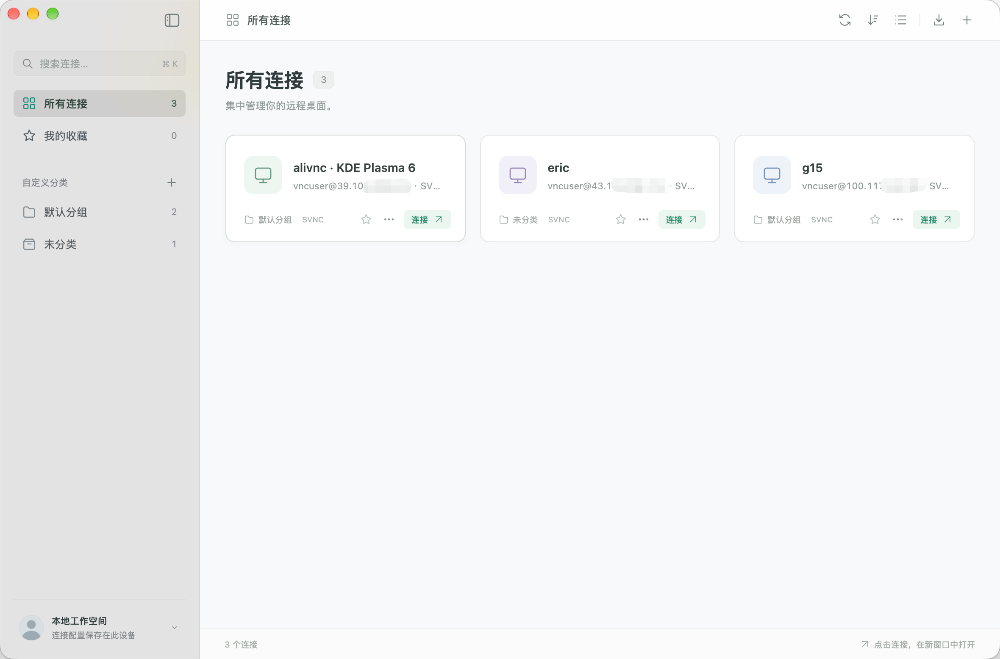
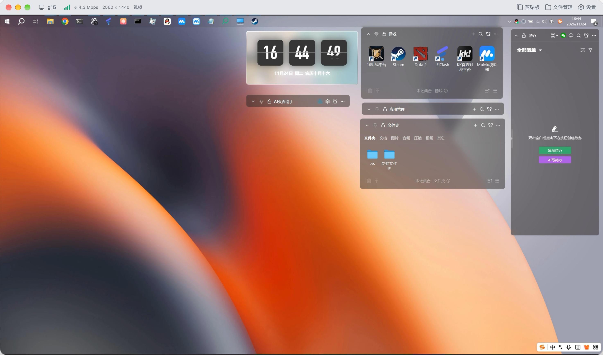

# JumpVNC

**SSH + VNC，让远程桌面与文件上传下载共用一个安全连接。**

JumpVNC 是 JumpServer 团队开发的远程桌面工具：VNC 提供桌面操作，SSH 提供身份认证、加密与连接复用，SFTP 提供文件上传下载。在同一个客户端中即可操作远程桌面、同步文本和传输文件。

目前提供 macOS 客户端，以及 Windows、Linux 服务端。JumpVNC 是产品名，SVNC 是接入协议名，可独立使用，无需部署 JumpServer。

**连接管理**



**远程桌面**



## 应用场景

- **远程办公与运维**：从 Mac 访问 Windows 或 Linux 桌面，操作业务软件、排查问题，并在本机与远程机器之间复制文本、上传和下载文件。
- **给 VNC 补上文件传输**：远程桌面操作时，直接将本机文件上传到远端，或将远端文件下载到本机，无需再单独打开文件传输工具。
- **简化网络接入**：桌面和文件共用一个 TCP 端口，适合希望减少防火墙开放端口、使用 SSH 公钥管理访问的环境。
- **无显示器的 Linux 桌面**：配合 Xvfb 提供远程图形环境，运行开发工具或图形化管理程序。见 [无显示器部署说明](deployments/linux/README.md)。

## 差异化特点

| 特点 | 使用体验 |
| --- | --- |
| **单端口** | SSH 承载 VNC 桌面与 SFTP 文件传输，默认只需开放 TCP `5922`。 |
| **文件传输** | 桌面窗口内浏览目录、拖放上传和下载文件，无需依赖 VNC 文件传输扩展。 |
| **SSH 认证** | 公钥认证、主机校验与传输加密，桌面和文件权限分别配置。 |
| **视频编码** | Windows 支持 H.264，优先使用硬件编码；文字办公可切换清晰模式。 |

Linux 当前支持 X11，Windows 共享控制台桌面；多个连接访问同一个桌面。目前不支持音频、多屏选择或 Wayland 桌面。

## 快速开始

### 1. 下载

打开 [GitHub Releases](https://github.com/jumpserver/jumpvnc/releases/latest)，下载对应平台的安装包。每个文件均提供 SHA-256 校验文件。

| 用途 | 平台 | 下载产物 |
| --- | --- | --- |
| 客户端 | macOS（Apple Silicon / Intel） | `jumpvnc-viewer-macos-universal` |
| 服务端 | Linux（amd64 / arm64） | `jumpvnc-server-linux-amd64` / `jumpvnc-server-linux-arm64` |
| 服务端 | Windows（amd64） | `jumpvnc-server-windows-amd64-setup.exe` |

### 2. 安装服务端

以下使用下载包中的程序部署，无需安装 Go、Node.js 或编译工具。安装程序自动生成连接密钥，也可在安装后改用已有 SSH 公钥。服务端只需向客户端开放 TCP `5922`，内部 VNC 端口 `5900` 保持回环监听。

#### Windows：双击安装

1. 双击 `jumpvnc-server-windows-amd64-setup.exe`，按提示授权安装。安装程序自动准备运行库、初始化配置、安装系统服务并添加防火墙规则。
2. 安装完成后打开 **JumpVNC Server** 管理窗口。主机密钥、连接密钥和 VNC 密码均已自动生成，默认用户名为 `vncuser`、端口为 `5922`；文件目录默认为公共文档下的 `JumpVNC Files`。
3. 点击“复制连接信息”获取地址、端口、用户名、密码和主机指纹；点击“复制连接私钥”获取客户端使用的 SSH 私钥。

双击托盘图标可随时打开管理窗口，修改用户名、监听地址、授权公钥、VNC 密码、文件目录及读写权限，保存后自动应用。也可替换授权公钥，改用已有的客户端密钥。

服务随系统启动，退出托盘不影响远程连接。再次运行安装程序可升级，保留已有配置与凭据；卸载会移除服务和防火墙规则，保留用户配置及文件。Windows 登录或锁屏界面仍需输入 Windows 账号凭据。

#### Linux：运行安装脚本

下载对应架构的 tar.gz，在已登录的 X11 桌面终端解压并安装（以下以 amd64 为例）：

```bash
tar -xzf jumpvnc-server-linux-amd64.tar.gz
cd jumpvnc-server-linux-amd64
bash install.sh
```

脚本自动安装程序、准备运行库、生成密钥和密码，并配置桌面登录自启。安装结束会显示连接信息和私钥文件位置；升级时重新运行新包中的脚本，原配置与凭据会保留。

当前下载包基于 Debian 13 构建，支持 amd64 / arm64。详细用法、服务管理及无显示器部署见 [Linux 安装说明](docs/linux-install.md)。

### 3. 连接桌面与传输文件

1. 在 Mac 上解压客户端，打开 `JumpVNC.app`，添加连接。
2. 协议选择 **SVNC**，填写服务器地址、端口 `5922` 和用户名 `vncuser`。连接私钥可从 Windows 管理窗口复制，或从 Linux 安装输出指示的文件获取，保存到 Mac 后在客户端“SSH 私钥文件”中填写路径。使用已有密钥时也可留空，客户端自动使用本机身份；加密私钥需先加入 SSH agent。
3. 首次连接时核对管理窗口显示的主机指纹，再输入 VNC 密码。Windows 的密码可在管理窗口显示，或通过“复制连接信息”获取；Linux 的密码和主机指纹会在安装结束时显示。
4. 进入桌面后，点击“文件管理”浏览远程目录，从 Finder 拖入文件上传，或选中文件下载到本机。文件管理需服务端已启用 SFTP。
5. 按需在“设置”中切换清晰或视频模式。当前窗口激活时，文本剪贴板自动双向同步。

更多操作见 [Viewer 使用说明](client/README.md)。已有 VNC Viewer 的 SSH 隧道接入方式见 [兼容接入](docs/protocol.md#71-ssh-本地转发)。

源码构建与测试见 [开发指南](docs/development.md)；协议与第三方集成见 [SVNC 规范](docs/protocol.md)。

**许可证**：项目采用 [GNU GPLv3](LICENSE)，第三方组件保留其各自许可，见 [第三方许可说明](THIRD_PARTY_NOTICES.md)。
